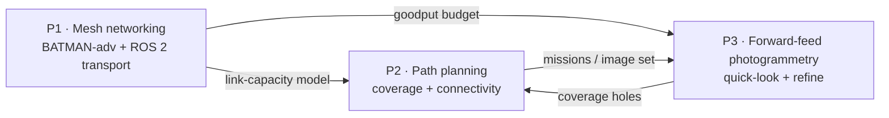

# MeshMap

**Live photogrammetric mapping from a UAV swarm whose only link is a multi-hop BATMAN-adv mesh.**

MeshMap asks how good a map a swarm can deliver *while it is still flying* when imagery and telemetry share a 0.3–10 Mbit/s multi-hop mesh to a ground server with no internet. Each UAV carries three Raspberry Pi cameras (one nadir, two oblique), a PX4 flight controller and a Pi 5 companion computer.

The work is split into three pipelines, one per team member. They share one testbed, one set of flights and one joint evaluation.



## Pipelines and owners

| | Pipeline | Owner | Code | Docs | Research question |
| --- | --- | --- | --- | --- | --- |
| **P1** | Mesh networking (BATMAN-adv) | *TBD* | [mesh/](mesh/) | [docs](docs/01-mesh-networking/README.md) | How much imagery and telemetry can a flying multi-hop mesh carry, and how fast does it recover? |
| **P2** | Path planning for photogrammetry | *TBD* | [planning/](planning/) | [docs](docs/02-path-planning/README.md) | Where should each UAV fly and shoot so the map is complete and the mesh stays connected? |
| **P3** | Forward-feed swarm photogrammetry | *TBD* | [photogrammetry/](photogrammetry/) | [docs](docs/03-forward-feed-photogrammetry/README.md) | What map quality is reachable live, per Mbit/s, and how much does refinement add? |
| — | Cross-pipeline (shared) | all | [common/](common/), [analysis/](analysis/) | [docs](docs/04-cross-pipeline/README.md) | How do the pipelines combine into one evaluation, papers and a schedule? |

The pipelines meet only at the **interfaces** in [docs/04-cross-pipeline/interfaces.md](docs/04-cross-pipeline/interfaces.md). As long as those hold, each owner can work independently.

## Repository layout

```
meshmap/
├── README.md                 # you are here
├── CONTRIBUTING.md           # branches, PRs, reviews, interface changes
├── docs/                     # research outline: academic + technical notes per pipeline
│   ├── 01-mesh-networking/
│   ├── 02-path-planning/
│   ├── 03-forward-feed-photogrammetry/
│   └── 04-cross-pipeline/    # joint evaluation, interfaces, architecture, timeline, risks
├── mesh/                     # P1 code: mesh bring-up, transport configs, measurement harness
├── planning/                 # P2 code: camera model, planners, SITL + netem
├── photogrammetry/           # P3 code: capture node, scheduler, ground pipeline, evaluator
├── common/                   # shared: message definitions, schemas, run.yaml, logging
├── analysis/                 # shared: scripts and notebooks for paper figures
└── runs/                     # flight/test data (git-ignored; see run layout in docs)
```

## Research questions

1. **RQ1 (P1)** How do tuned BATMAN-adv and the ROS 2 transports (Zenoh vs tuned DDS) behave in flight over 1–3+ hops with real image payloads?
2. **RQ2 (P2)** Can one planner optimise photogrammetric coverage, oblique view geometry and mesh goodput together, and beat a lawnmower baseline on flight time and relay outages without losing accuracy?
3. **RQ3 (P3)** How does map accuracy (RMSE on held-out RTK check points) trade off against delivered bytes, for quick-look-then-refine vs send-all and offline baselines?
4. **RQ4 (joint)** How much accuracy is lost per millisecond of capture-timestamp error and per hop of mesh latency?

The research contribution is the bandwidth- and mesh-aware forward-feed architecture plus a joint evaluation reporting network metrics and GCP accuracy from the same flights. Details: [docs/README.md](docs/README.md).

## Status and timeline

Outline stage (October 2026). Bench and SITL work over winter 2026–27, flight campaigns April–August 2027. First paper targeted for ~February 2027 (ICUAS, *verify* dates). Full schedule and risks: [cross-pipeline technical notes](docs/04-cross-pipeline/technical.md#timeline).

## Working together

- Each owner works in their own folder and docs subfolder; changes there need only a light review.
- Changes to `common/` or to [interfaces.md](docs/04-cross-pipeline/interfaces.md) need approval from every pipeline they touch.
- Branch naming, PR rules and the docs checklist are in [CONTRIBUTING.md](CONTRIBUTING.md).
