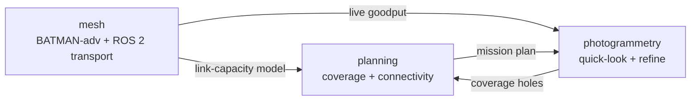

# MeshMap

**Live photogrammetric mapping from a UAV swarm whose only link is a multi-hop BATMAN-adv mesh.**

MeshMap asks how good a map a swarm can deliver *while it is still flying* when imagery and telemetry share a 0.3–10 Mbit/s multi-hop mesh to a ground server with no internet. Each UAV carries three Raspberry Pi cameras (one nadir, two oblique), a PX4 flight controller and a Pi 5 companion computer.

Three people each own one pipeline. The pipelines share one testbed, one set of flights and one joint evaluation, and they meet only at a few well-defined [interfaces](integration/interfaces/README.md).



## Who owns what

| Folder | Pipeline | Owner | Research question |
| --- | --- | --- | --- |
| [mesh/](mesh/README.md) | Mesh networking (P1) | *TBD* | **RQ1** How do tuned BATMAN-adv and the ROS 2 transports (Zenoh vs tuned DDS) behave in flight over 1–3+ hops with real image payloads? |
| [planning/](planning/README.md) | Path planning (P2) | *TBD* | **RQ2** Can one planner optimise coverage, oblique view geometry and mesh goodput together, and beat a lawnmower baseline on flight time and relay outages without losing accuracy? |
| [photogrammetry/](photogrammetry/README.md) | Forward-feed photogrammetry (P3) | *TBD* | **RQ3** How does map accuracy (RMSE on RTK check points) trade off against delivered bytes, for quick-look-then-refine vs send-all and offline baselines? |
| [integration/](integration/README.md) | Joint work | all three | **RQ4** How much accuracy is lost per millisecond of capture-timestamp error and per hop of mesh latency? |

Each pipeline folder is that person's space: its README shows current status and what it gives to and takes from the others.

## Documentation map

This README is the main doc. Every other doc is linked from here.

| Area | Overview | Academic (research) | Technical (engineering) |
| --- | --- | --- | --- |
| Mesh networking | [mesh/README.md](mesh/README.md) | [State of the art, gaps, RQ1, evaluation, C3/C5, venues](mesh/docs/academic.md) | [Architecture, hardware, BATMAN-adv, ROS 2 transports, time sync, harness, tests](mesh/docs/technical.md) |
| Path planning | [planning/README.md](planning/README.md) | [State of the art, gaps, RQ2, formal problem, evaluation, C7](planning/docs/academic.md) | [Planner, GSD/footprint maths, rig layouts, software, SITL + netem, missions](planning/docs/technical.md) |
| Forward-feed photogrammetry | [photogrammetry/README.md](photogrammetry/README.md) | [State of the art, gaps, RQ3, three-arm evaluation, C1/C2/C4/C6](photogrammetry/docs/academic.md) | [Data flow, camera rig, geotagging, scheduler, ground processing, field setup](photogrammetry/docs/technical.md) |
| Integration | [integration/README.md](integration/README.md) | [Positioning, contributions C1–C7, venues, joint evaluation, novelty check](integration/docs/academic.md) | [System architecture, bill of materials, run layout, timeline, risks](integration/docs/technical.md) |

Shared between pipelines:

- [Interfaces](integration/interfaces/README.md): [link-capacity model](integration/interfaces/link-model.md) · [live goodput](integration/interfaces/goodput.md) · [mission plan](integration/interfaces/mission-plan.md) · [image record](integration/interfaces/image-record.md) · [coverage holes](integration/interfaces/coverage-holes.md) · [run metadata](integration/interfaces/run-metadata.md)
- [Decision records](integration/decisions/README.md)
- [How we work together](CONTRIBUTING.md)

## Repository layout

```
meshmap/
├── README.md               main doc (you are here)
├── mesh/                   ┐
├── planning/               │ one per owner, same shape:
├── photogrammetry/         ┘   README.md  status, inputs/outputs, contents
│                               docs/      academic.md, technical.md
│                               <code>/    added as work starts
├── integration/            shared by all three
│   ├── interfaces/         one file per hand-off between pipelines
│   ├── decisions/          dated decision records
│   └── docs/               positioning, contributions, venues, system, timeline, risks
├── CONTRIBUTING.md         how we work together
└── runs/                   flight and test data (git-ignored, on the shared drive)
```

Why this shape: see the [decision record](integration/decisions/2026-10-16-split-repo-by-owner.md).

## How we work together

- **Own your folder.** Changes inside your pipeline folder need only your own review.
- **Agree on interfaces.** A change to anything in [integration/interfaces/](integration/interfaces/README.md) needs approval from its producer and every consumer.
- **Write down shared decisions** as short [decision records](integration/decisions/README.md).
- **Keep your status current.** Update the Status block in your pipeline README before the weekly sync.

Details in [CONTRIBUTING.md](CONTRIBUTING.md).

## Status and timeline

Outline stage (October 2026). Bench and SITL work over winter 2026–27, flight campaigns April–August 2027, first paper targeted for ~February 2027 (ICUAS, *verify* dates). Schedule and risks: [integration technical notes](integration/docs/technical.md#timeline).
