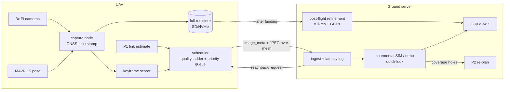

# P3 Forward-feed swarm photogrammetry — Technical

[← P3 index](README.md) · [Academic](academic.md)

How images are captured, scheduled over the mesh, and turned into maps.

## Data flow



## Camera rig

A Pi 5 has **two** CSI ports, so three cameras that capture at the same time need one of these designs (decide first):

| Option | Design | Sync | Notes |
| --- | --- | --- | --- |
| A | Pi 5 (2 cams) + Pi Zero 2 W or second Pi (1 cam) | GNSS-PPS time on both; software trigger | Simplest; two clocks to keep in sync |
| B | Three Pi Zero 2 W, one camera each, Pi 5 as hub | PPS shared to all; per-board stamps | Light; more boards to manage |
| C | Arducam multi-camera array HAT (merged synchronised stream) | Hardware-synchronised (*verify* per model) | One stream; lower resolution per camera |
| D | Global Shutter Camera (IMX296) ×3 with external trigger | Hardware trigger from one GPIO | 1.6 MP only; no rolling-shutter distortion |

| Camera | Sensor | Resolution | Shutter | Note |
| --- | --- | --- | --- | --- |
| Camera Module 3 | IMX708 | 4608 × 2592 | Rolling | Autofocus must be locked (`--lens-position` fixed) |
| HQ Camera | IMX477 | 4056 × 3040 | Rolling | C/CS lens; better optics |
| Global Shutter | IMX296 | 1456 × 1088 | Global | External trigger support |

Capture settings: fixed focus, shutter speed ≤ 1/1000 s, fixed white balance, and JPEG quality 95 for the stored original. Enable rolling-shutter compensation in Metashape/ODM for the CM3/HQ cameras.

## Capture and geotagging

- PX4 triggers by distance. The capture node records the **GNSS/PPS-disciplined system time** when the frame is exposed. Use the libcamera `SensorTimestamp` metadata rather than the time the file is written.
- Pose prior = MAVROS `/mavros/global_position/global` + attitude, interpolated to the capture timestamp. Never stamp on the ground after the mesh hop.
- Cross-check against PX4 `camera_capture` feedback events in the ULog.
- Rig extrinsics come from a calibration flight or target board, and are applied as fixed rig constraints in bundle adjustment.

## Image record (one per capture)

```json
{
  "id": "uav1-cam0-000123",
  "uav": "uav1", "cam": 0,
  "t_capture_gnss": "2027-05-20T10:31:12.481203Z",
  "lat": 65.0593, "lon": 25.4663, "alt_amsl": 92.4,
  "roll": 0.8, "pitch": -1.2, "yaw": 87.5,
  "pos_std_m": 1.5,
  "keyframe_score": 0.73,
  "sent": [{"rung": "thumb", "bytes": 48211, "t_send": "...", "t_recv": "...", "hops": 2}],
  "file_fullres": "runs/2027-05-20/r03/uav1/cam0/000123.jpg"
}
```

## Scheduler

**Quality ladder.** Byte sizes are estimates for a 12 MP sensor; measure them on real frames.

| Rung | Resolution | JPEG q | Approx. size | Use |
| --- | --- | --- | --- | --- |
| thumb | 640 px long side | 70 | ~40–60 KB | Coverage display, keyframe check |
| quick | ~1.2 MP (OpenREALM-like) | 85 | ~250–400 KB | Live SfM / ortho |
| full | native | 95 | ~4–8 MB | Reachback only, or after landing |

**Policy:**

1. Telemetry always goes first (separate high-priority queue).
2. Every capture → `image_meta` + `thumb`.
3. Keyframe score = new ground covered vs already-sent footprints + overlap with neighbours + view-angle diversity. The top-scored frames go up at the `quick` rung.
4. The rung is chosen so the queue drains within *T* seconds, given the current goodput estimate from P1 (EWMA of measured send rate).
5. The ground can request `full` for specific ids (reachback) when a hole or weak tie-point region appears.

Transport: ROS 2 `sensor_msgs/CompressedImage` over the Zenoh bridge (P1). Fallback: chunked file transfer over QUIC/HTTP, so one lost fragment doesn't drop the whole image.

## Ground processing

| Stage | Tool | Output |
| --- | --- | --- |
| Quick-look | OpenREALM (ROS) or COLMAP/GLOMAP incremental with GNSS priors | Live ortho tiles + sparse cloud |
| Viewer | Leaflet/OpenLayers over XYZ tiles, or Foxglove | Map + per-image latency overlay |
| Refinement | OpenDroneMap (open) and Agisoft Metashape (reference) with GCPs | Ortho, DSM, dense cloud |
| Accuracy | Script: check points → horizontal/vertical RMSE; CloudCompare cloud-to-cloud | Metrics CSV |

Ground server: workstation or laptop with an NVIDIA GPU (CUDA), no internet, running a local tile server.

## Field setup

- 10–15 GCPs plus 10–20 held-out check points, surveyed with RTK GNSS (≤ 2 cm). Spread them over the AOI and along its edges.
- The same AOI is used for P2 and P3 campaigns.
- Record weather, temperature, terrain texture, altitude, overlap and node count for every flight.

## Technical todo

- [ ] Decide rig option (A–D); order cameras, lenses, mounts
- [ ] Calibrate intrinsics (checkerboard) and rig extrinsics; measure sync spread with an LED/timer target
- [ ] Capture node: libcamera/picamera2, sensor timestamps, pose interpolation, onboard store
- [ ] Keyframe scorer + quality ladder + scheduler with goodput estimate
- [ ] Reachback service (ground → UAV request for full-res ids)
- [ ] Ground ingest + latency logger; quick-look pipeline; tile viewer
- [ ] Post-flight refinement scripts (ODM + Metashape) and RMSE evaluator
- [ ] Compression and timing-injection study scripts
- [ ] Optional: Jetson Orin companion for onboard keyframe selection; log power (tegrastats)
