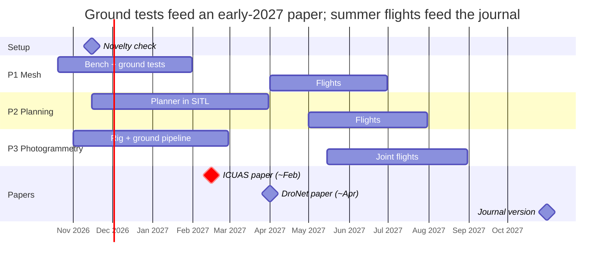

# Cross-pipeline plan

All three pipelines share one flight dataset. Every flight logs network, timing and photogrammetric data together. One campaign can therefore support three papers: networking (C3, C5), accuracy (C1, C4) and methods (C2).

## Joint evaluation

| Layer | Metrics | Pass/fail target |
| --- | --- | --- |
| Network (P1) | Per-hop and end-to-end goodput, per-image capture-to-ground latency (p50/p95), PDR, route convergence time, discovery bytes per hop | Telemetry PDR ≥ 99%; convergence measured in seconds |
| Planning (P2) | Flight time, energy, outage seconds, image count, coverage completeness | Equal or better completeness than lawnmower, fewer outage seconds |
| System (P3) | Time-to-first-map, time-to-complete-map, bytes per km² vs send-all, CPU/GPU load and power | First usable overview within minutes of coverage (inferred target) |
| Photogrammetry (P3) | Horizontal/vertical RMSE on held-out RTK check points, reprojection error, completeness, GSD | ≤10 cm GSD; ~1 m live without GCPs; decimetre after refinement ([Copernicus EMS](https://mapping.emergency.copernicus.eu/about/rapid-mapping-portfolio/), [Kern 2021](https://isprs-archives.copernicus.org/articles/XLIII-B1-2021/165/2021/)) |
| Timing (all) | Camera-to-autopilot offset, inter-camera sync spread, RMSE change under injected offsets | Sync error small enough that velocity × offset < GSD |

Record weather, temperature, terrain texture, altitude, overlap, node count and antenna placement on every flight.

## Timeline

Proposed schedule. Venue dates follow past cycles and are unverified.

The first paper uses bench and ground mesh results plus preliminary accuracy. The joint flights in summer 2027 provide the data for the journal version.

## Contributions and venues

| # | Contribution | Pipeline | First target |
| --- | --- | --- | --- |
| C1 | Joint network + GCP-accuracy evaluation on 1–3 hop BATMAN-adv | P1 + P3 | ICUAS 2027, then MDPI Drones |
| C2 | Image scheduling that adapts to the mesh link and to SfM needs | P3 | DroNet 2027 |
| C3 | ROS 2 transport benchmark over flying BATMAN-adv | P1 | ICUAS / JIRS |
| C4 | Low-cost 3-Pi nadir + oblique rig, sync-error study | P3 | ISPRS GSW / UAV-g 2027 |
| C5 | Tuned BATMAN-adv in flight, convergence time, 3+ hops | P1 | IEEE VTC / GLOBECOM workshops |
| C6 | Onboard keyframe pre-filtering on a Jetson | P3 | DroneSys 2027 |
| C7 | Photogrammetric path planning for a mesh swarm that accounts for link goodput | P2 | ICUAS / IROS 2027 |

C7 is new to this outline. It comes from the P2 gap: existing planners treat connectivity as range, never as measured multi-hop goodput. For ICUAS, use only uasconferences.com, because look-alike listings are predatory.

## Risks

| Risk | Effect | Mitigation |
| --- | --- | --- |
| Recent IEEE paper already covers C1/C3 | Novelty claim fails | Scholar + Xplore check before writing; forward citations of Guillen-Perez 2021, Chovet 2025, OpenREALM |
| Pi onboard Wi-Fi range ~60 m | Too few hops at useful altitude | USB or mini-PCIe radios; ground relays; fly higher |
| Winter weather and cold batteries | Lost flight days | Bench and SITL work in winter; flights Apr–Aug; Arctic trials as a later extension |
| Inter-camera or GNSS timing drift | Geotag error dominates RMSE | GNSS/PPS stamping at capture; measure sync spread first |
| Flight permits for multi-UAV | Campaign delay | Apply early; use a fixed test site |

## Novelty check (before any submission)

- [ ] Search Google Scholar and IEEE Xplore for these combinations:
    - "BATMAN-adv" + "ROS 2"
    - "rmw_zenoh UAV"
    - mesh + "real-time photogrammetry" / orthomosaic
    - "FANET image offloading SfM"
    - "multi-camera Raspberry Pi UAV oblique"
    - connectivity-aware + reconstruction path planning
- [ ] Forward citations of Guillen-Perez 2021, Chovet 2025, OpenREALM 2020, Samshad & Rajawat 2024
- [ ] Read arXiv 2606.27028 for overlap with C3/C5
- [ ] Verify unverified items: CMU EarlyDiscard venue, BATMAN-adv tuning values, all venue dates except MDPI Drones

## Sources

Sources for each research study are cited inline in the pipeline docs. P1 and P3 sources come from the supplied literature review, checked in October 2026. P2 sources were looked up for this outline. Hardouin et al. (IROS 2020) and the Zhou et al. 2020 survey are leads that have not been read yet.
