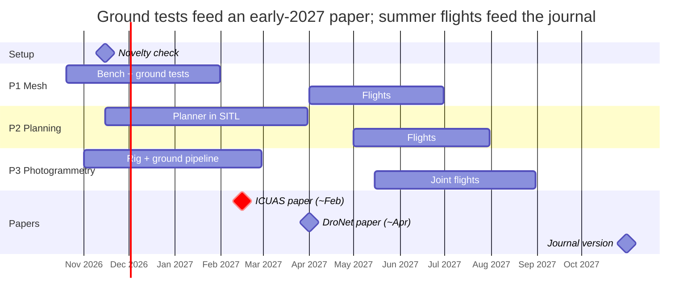

# Cross-pipeline — Technical

[← Cross-pipeline index](README.md) · [Academic](academic.md)

Shared system architecture, hardware, data layout, schedule and risks.

## System architecture

```mermaid
flowchart TB
    subgraph UAVn[Each UAV]
        PX4[PX4 flight controller] -- serial/MAVLink --> MAVROS
        GNSS[GNSS + PPS] --> CHRONY[chrony]
        CAMS[3x Pi cameras] --> CAP[capture node]
        MAVROS --> CAP
        CAP --> SCH[scheduler]
        SCH --> BR[zenoh bridge]
        MAVROS --> BR
        BR --> BAT[bat0 / BATMAN-adv]
    end
    BAT <-. multi-hop mesh .-> RELAY[relay UAV / ground relay]
    RELAY <-. .-> GBAT
    subgraph GS[Ground server, no internet]
        GBAT[bat0] --> GBR[zenoh bridge]
        GBR --> ING[ingest + logs]
        ING --> QL[quick-look map]
        QL --> PLAN[P2 planner / re-plan]
        PLAN --> GBR
        POST[post-flight refinement] --> EVAL[RMSE + network metrics]
        ING --> EVAL
    end
```

## Bill of materials (per UAV, draft)

| Item | Qty | Notes |
| --- | --- | --- |
| Multirotor airframe with PX4 FC (Pixhawk-class) | 1 | Payload ≥ 500 g for rig + Pi + radio |
| Raspberry Pi 5 (8 GB) + active cooler | 1 | Companion computer |
| Pi cameras (see [P3 rig options](../03-forward-feed-photogrammetry/technical.md#camera-rig)) | 3 | Plus mounts at the chosen tilt |
| Extra Pi (Zero 2 W) if rig option A/B | 1–3 | |
| Wi-Fi adapter (IBSS + mesh point) + dual-band dipoles | 1 | See [P1 hardware](../01-mesh-networking/technical.md#hardware) |
| GNSS with PPS (u-blox M9/F9P) | 1 | PPS → GPIO 18 |
| NVMe or high-endurance SD (≥ 256 GB) | 1 | Full-res store |
| 5 V BEC (≥ 5 A) + USB power meter | 1 | Pi 5 power budget + energy logging |

Ground side: GPU workstation or laptop, 1–2 ground relay nodes (Pi 5 + same radio on a mast), RTK base + rover for the GCP survey.

## Run and data layout

```
runs/
  2027-05-20/
    r03/                      # one run = one flight / one factor setting
      run.yaml                # factors: routing, underlay, transport, planner, arm, hops, weather
      uav1/
        cam0/ cam1/ cam2/     # full-res JPEG originals
        images.jsonl          # one image record per capture (P3 schema)
        net/                  # iperf, batctl, station dump, tcpdump, chrony
        px4.ulg
      ground/
        ingest.jsonl          # receive times, bytes, rung
        quicklook/  refined/  # map products
        metrics.csv           # RMSE, completeness, latency summaries
```

All timestamps are UTC from GNSS-disciplined clocks.

## Repository layout

```
docs/                      # this outline (academic + technical per pipeline)
mesh/                      # P1: mesh-up scripts, Ansible, transport configs, harness
planning/                  # P2: camera model, planners, SITL launch, netem
photogrammetry/            # P3: capture node, scheduler, ground pipeline, evaluator
common/                    # schemas and messages for the interfaces, run logging
analysis/                  # notebooks/scripts for figures
```

Each code folder has a README with its owner and planned subfolders. Contracts between pipelines: [interfaces.md](interfaces.md). Ownership and review rules: [CONTRIBUTING.md](../../CONTRIBUTING.md).

## Timeline

Proposed schedule. Venue dates follow past cycles and are unverified.



The first paper uses bench and ground mesh results plus preliminary accuracy. The joint flights in summer 2027 provide the data for the journal version.

## Risks

| Risk | Effect | Mitigation |
| --- | --- | --- |
| Recent IEEE paper already covers C1/C3 | Novelty claim fails | Novelty check before writing ([academic](academic.md#novelty-check-before-any-submission)) |
| Pi onboard Wi-Fi range ~60 m | Too few hops at useful altitude | USB or mini-PCIe radios; ground relays; fly higher |
| Pi 5 has only 2 CSI ports | 3-camera rig harder than planned | Rig options A–D in P3 technical |
| Winter weather and cold batteries | Lost flight days | Bench and SITL work in winter; flights Apr–Aug; Arctic trials as a later extension |
| Inter-camera or GNSS timing drift | Geotag error dominates RMSE | GNSS/PPS stamping at capture; measure sync spread first |
| Flight permits for multi-UAV | Campaign delay | Apply early; use a fixed test site |
| Payload weight / power on small airframes | Short flights, fewer runs | Weigh the rig early; log energy per flight |
