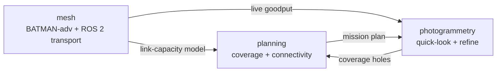

# MeshMap documentation

[← Repository](../README.md)

The main doc. It gives the project overview and links to every other doc in the repo. Each pipeline keeps its detailed docs in its own folder; this page only points to them.

## Overview

MeshMap asks how good a map a UAV swarm can deliver *while it is still flying* when imagery and telemetry share a 0.3–10 Mbit/s multi-hop BATMAN-adv mesh to a ground server with no internet. Each UAV carries three Raspberry Pi cameras (one nadir, two oblique), a PX4 flight controller and a Pi 5 companion computer.

Three pipelines, one per team member, share one testbed, one set of flights and one joint evaluation. They meet only at a few well-defined [interfaces](../integration/interfaces/README.md).

## Research questions

1. **RQ1 (mesh)** How do tuned BATMAN-adv and the ROS 2 transports (Zenoh vs tuned DDS) behave in flight over 1–3+ hops with real image payloads?
2. **RQ2 (planning)** Can one planner optimise coverage, oblique view geometry and mesh goodput together, and beat a lawnmower baseline on flight time and relay outages without losing accuracy?
3. **RQ3 (photogrammetry)** How does map accuracy (RMSE on RTK check points) trade off against delivered bytes, for quick-look-then-refine vs send-all and offline baselines?
4. **RQ4 (integration)** How much accuracy is lost per millisecond of capture-timestamp error and per hop of mesh latency?

## Documentation map

| Area | Overview | Academic (research) | Technical (engineering) |
| --- | --- | --- | --- |
| Mesh networking | [mesh/](../mesh/README.md) | [State of the art, gaps, RQ1, evaluation, C3/C5, venues](../mesh/docs/academic.md) | [Architecture, hardware, BATMAN-adv, ROS 2 transports, time sync, harness, tests](../mesh/docs/technical.md) |
| Path planning | [planning/](../planning/README.md) | [State of the art, gaps, RQ2, formal problem, evaluation, C7](../planning/docs/academic.md) | [Planner, GSD/footprint maths, rig layouts, software, SITL + netem, missions](../planning/docs/technical.md) |
| Forward-feed photogrammetry | [photogrammetry/](../photogrammetry/README.md) | [State of the art, gaps, RQ3, three-arm evaluation, C1/C2/C4/C6](../photogrammetry/docs/academic.md) | [Data flow, camera rig, geotagging, scheduler, ground processing, field setup](../photogrammetry/docs/technical.md) |
| Integration | [integration/](../integration/README.md) | [Positioning, contributions C1–C7, venues, joint evaluation, novelty check](../integration/docs/academic.md) | [System architecture, bill of materials, run layout, timeline, risks](../integration/docs/technical.md) |

Shared between pipelines:

- [Interfaces](../integration/interfaces/README.md): [link-capacity model](../integration/interfaces/link-model.md) · [live goodput](../integration/interfaces/goodput.md) · [mission plan](../integration/interfaces/mission-plan.md) · [image record](../integration/interfaces/image-record.md) · [coverage holes](../integration/interfaces/coverage-holes.md) · [run metadata](../integration/interfaces/run-metadata.md)
- [Decision records](../integration/decisions/README.md)
- [How we work together](../CONTRIBUTING.md)
- [Claude skills](claude-skills.md): planned Claude Code skills for this repo, where they live and who owns them

When you add a doc anywhere in the repo, add a link to it here.

## Status and timeline

Outline stage (October 2026). Bench and SITL work over winter 2026–27, flight campaigns April–August 2027, first paper targeted for ~February 2027 (ICUAS, *verify* dates). Each pipeline's current status is at the top of its README. Schedule and risks: [integration technical notes](../integration/docs/technical.md#timeline).
