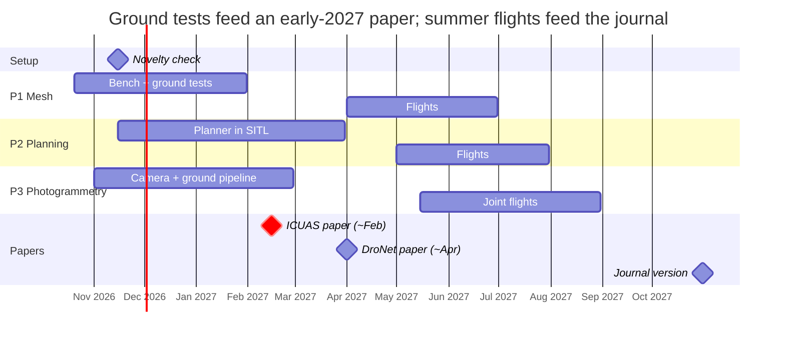

# Integration — Technical

[← Main doc](../../docs/README.md) · [Integration overview](../README.md) · [Academic](academic.md)

Shared system architecture, hardware, data layout, schedule and risks.

## System architecture

```mermaid
flowchart TB
    subgraph UAVn[Each UAV]
        PX4[Pixracer / PX4] -- TELEM2 MAVLink --> MAVROS
        GNSS[GNSS + PPS] --> CHRONY[chrony]
        CAM[SIYI A8 mini] -- Ethernet: SDK, HTTP --> CAP[capture node]
        MAVROS -- CAMERA_TRIGGER, pose --> CAP
        CAP --> SCH[scheduler]
        SCH --> BR[zenoh bridge]
        MAVROS --> BR
        BR --> BAT[bat0 / BATMAN-adv]
    end
    BAT <-. multi-hop mesh .-> RELAY[relay UAV / ground relay]
    RELAY <-. .-> GBAT
    subgraph GS[Ground server, no internet]
        GBAT[bat0] --> GBR[zenoh bridge]
        GBR --> ING[ingest + logs]
        ING --> QL[quick-look map]
        QL --> PLAN[P2 planner / re-plan]
        PLAN --> GBR
        POST[post-flight refinement] --> EVAL[RMSE + network metrics]
        ING --> EVAL
    end
```

## Bill of materials (per UAV, draft)

| Item | Qty | Notes |
| --- | --- | --- |
| Multirotor airframe | 1 | Payload ≥ 350 g for camera + Pi + radio + GNSS (*verify* after weighing) |
| mRo Pixracer (FMUv4) running PX4 | 1 | `px4_fmu-v4_default`; TELEM2 → Pi (MAVROS), TELEM1 free for a backup telemetry radio ([PX4 Pixracer](https://docs.px4.io/main/en/flight_controller/pixracer)) |
| Raspberry Pi 5 (8 GB) + active cooler | 1 | Companion computer: MAVROS, capture node, scheduler, mesh |
| SIYI A8 mini gimbal camera | 1 | 95 g; Ethernet to the Pi; own power input (*verify* voltage range for our airframe); see [P3 camera](../../photogrammetry/docs/technical.md#camera-siyi-a8-mini) |
| microSD for the A8 mini (Class 10) | 1 | Camera-side copy of every still |
| Wi-Fi adapter (IBSS + mesh point) + dual-band dipoles | 1 | See [P1 hardware](../../mesh/docs/technical.md#hardware) |
| GNSS with PPS (u-blox M9/F9P) | 1 | Pixracer GPS port for navigation; PPS line broken out to Pi GPIO 18 (*verify* the module exposes PPS), or a second receiver for the Pi |
| NVMe or high-endurance SD (≥ 256 GB) | 1 | Full-res store |
| 5 V BEC (≥ 5 A) + USB power meter | 1 | Pi 5 power budget + energy logging |
| FTDI/JST-GH cable, Pixracer TELEM2 → Pi UART | 1 | Or USB-serial; 921600 baud (*verify*) |

Ground side: GPU workstation or laptop, 1–2 ground relay nodes (Pi 5 + same radio on a mast), RTK base + rover for the GCP survey.

## Run and data layout

```
runs/
  2027-05-20/
    r03/                      # one run = one flight / one factor setting
      run.yaml                # factors per pipeline (interfaces/run-metadata.md)
      uav1/
        cam0/                 # full-res JPEG originals fetched from the A8 mini
        gimbal.csv            # SIYI SDK attitude log
        images.jsonl          # one image record per capture (interfaces/image-record.md)
        net/                  # iperf, batctl, station dump, tcpdump, chrony
        px4.ulg
      ground/
        ingest.jsonl          # receive times, bytes, rung
        quicklook/  refined/  # map products
        metrics.csv           # RMSE, completeness, latency summaries
```

All timestamps are UTC from GNSS-disciplined clocks.

## Repository layout

The repo is split by owner, not by file type. Each pipeline folder is self-contained (docs, code, analysis), and `integration/` holds everything the three share. See the [root README](../../README.md#repository-layout) for the tree and [CONTRIBUTING](../../CONTRIBUTING.md) for the review rules.

## Timeline

Proposed schedule. Venue dates follow past cycles and are unverified.



The first paper uses bench and ground mesh results plus preliminary accuracy. The joint flights in summer 2027 provide the data for the journal version.

## Risks

| Risk | Effect | Mitigation |
| --- | --- | --- |
| Recent IEEE paper already covers C1/C3 | Novelty claim fails | Novelty check before writing ([academic](academic.md#novelty-check-before-any-submission)) |
| Pi onboard Wi-Fi range ~60 m | Too few hops at useful altitude | USB or mini-PCIe radios; ground relays; fly higher |
| A8 mini has no sensor timestamp; software trigger latency and jitter unknown | Geotag error dominates live RMSE | Bench latency calibration before any flight; record jitter in every image record; timing-injection study (RQ4) |
| One gimbal camera instead of a fixed oblique rig | Obliques cost flight time or trigger rate | Compare oblique strategies in SITL first (P2 RQ2.2) |
| SIYI SDK/firmware differs from published docs (forum reports) | Commands or media API misbehave | Pin the camera firmware version per run (`run.yaml`); test every command on the bench |
| Pixracer: 2 MB flash, no uXRCE-DDS client in the default build | Some PX4 features unavailable | MAVROS only; check each needed module is in `px4_fmu-v4_default` before relying on it |
| Winter weather and cold batteries | Lost flight days | Bench and SITL work in winter; flights Apr–Aug; Arctic trials as a later extension |
| GNSS or FC-to-Pi clock drift | Geotag error dominates RMSE | GNSS/PPS on the Pi; MAVROS timesync; log chrony offsets per run |
| Flight permits for multi-UAV | Campaign delay | Apply early; use a fixed test site |
| Payload weight / power on small airframes | Short flights, fewer runs | Weigh camera + Pi + radio early; log energy per flight |
