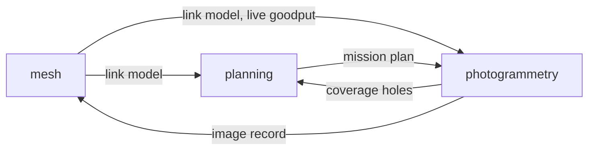

# Interfaces

[← Integration overview](../README.md)

The contracts between the three pipelines. This is the only place where one person's work depends on another's, so it is the only place where changes need everyone's agreement. Inside your own pipeline folder you can change anything.

**Status: draft.** Field names and topics are proposals until the first bench integration.

## How it works

- **One file per interface.** Different people can edit different contracts at the same time without merge conflicts, and [CODEOWNERS](../../.github/CODEOWNERS) can require review from exactly the right people.
- **The producer owns the contract; consumers sign it.** The pipeline that produces the data writes and maintains the file. Every consumer listed in the file must approve a change. This follows the consumer-driven contracts idea ([Fowler](https://www.martinfowler.com/articles/consumerDrivenContracts.html)): the producer may change anything no consumer relies on.
- **Versioned.** Each file has a `version` (`MAJOR.MINOR`). Adding an optional field is a minor bump. Renaming, removing or changing the meaning of a field is a major bump, and the producer keeps the old version working until every consumer has switched.
- **Schemas sit next to the prose.** When an interface is implemented, add its machine-readable form beside the file (`image-record.schema.json`, a ROS 2 `.msg`), and test against example files in both the producer's and the consumers' code.

## Contracts

| Interface | Producer | Consumers | Form | When |
| --- | --- | --- | --- | --- |
| [Link-capacity model](link-model.md) | mesh | planning, photogrammetry | JSON file | Offline, after each test campaign |
| [Live goodput](goodput.md) | mesh | photogrammetry | ROS 2 topic | In flight, 1 Hz |
| [Mission plan](mission-plan.md) | planning | photogrammetry, flight ops | PX4 mission + `plan.json` | Before flight and on re-plan |
| [Image record](image-record.md) | photogrammetry | mesh, integration | `images.jsonl` + ROS 2 topic | Per capture |
| [Coverage holes](coverage-holes.md) | photogrammetry | planning | ROS 2 topic (GeoJSON) | In flight, after each quick-look update |
| [Run metadata](run-metadata.md) | all (shared) | all | `run.yaml` | Per run |

## Shared conventions

These apply to every interface.

- **Time:** UTC from GNSS/PPS-disciplined clocks (chrony). ISO 8601 with microseconds in files; `builtin_interfaces/Time` in ROS messages.
- **Coordinates:** WGS84 lat/lon + `alt_amsl` in files; UTM (zone of the test site) for planning maths. Angles in degrees.
- **Units:** SI. Bit rates in Mbit/s, sizes in bytes.
- **Node names:** `uav1`, `uav2`, …; ground nodes `gnd`, `relay1`, …
- **ROS namespaces:** `/<node>/meshmap/<topic>`. Only allow-listed topics cross the mesh (see [mesh transport](../../mesh/docs/technical.md#ros-2-transport-configurations)).

## Adding or changing an interface

1. Open a PR that edits the interface file (or adds a new one from an existing file's layout) and bumps its version.
2. Tag the producer and every consumer. The PR is merged when all of them approve.
3. Add a line to the file's change log.
4. If the change comes from a design choice with alternatives, also write a [decision record](../decisions/README.md).
