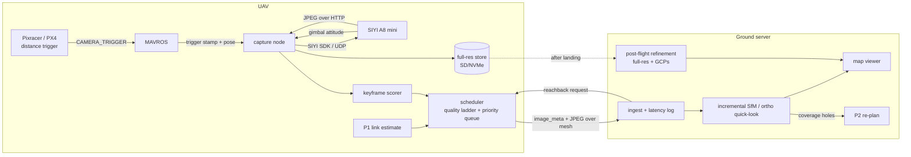

# P3 Forward-feed swarm photogrammetry — Technical

[← Main doc](../../docs/README.md) · [P3 overview](../README.md) · [Academic](academic.md)

How images are captured, scheduled over the mesh, and turned into maps.

## Data flow



## Camera: SIYI A8 mini

One A8 mini per UAV, on the Pi 5's Ethernet port ([decision](../../integration/decisions/2026-10-16-uav-hardware-a8mini-pi5-pixracer.md)). Specs below come from vendor listings and the [ArduPilot SIYI page](https://ardupilot.org/copter/docs/common-siyi-zr10-gimbal.html). None has been measured on our unit yet.

| Property | Value | Status |
| --- | --- | --- |
| Sensor | Sony 1/1.7", 8 MP effective | Listings ([IRLock](https://irlock.com/products/siyi-a8-mini-4k-8mp-ultra-hd-6x-digital-zoom-gimbal-camera-with-1-1-7-sony-sensor-ai-smart-identify-and-tracking-hdr-starlight-night-vision-mini-3-axis-stabilizer-95g-lightweight-55x55x70mm-for-uav-ugv-usv-rc-planes-and-fpv-drones), [ArduPilot forum](https://discuss.ardupilot.org/t/siyi-a8-mini-4k-ai-mini-zoom-gimbal-camera-ai-identify-tracking-4k-1-1-7-inch-8mp-sony-sensor-6x-zoom/92133)) |
| Still size | 3840 × 2160 assumed; some listings say 4096 × 2160 | *verify* on a real JPEG |
| Lens | Fixed, 21 mm equivalent, F2.8; HFOV 81°, DFOV 93° | Listings; derived f ≈ 2250 px ≈ 4.5 mm at 2.0 µm pitch (*verify* by calibration) |
| Zoom | 6× digital only | Keep at 1× for mapping |
| Shutter | Rolling assumed | *verify* |
| Gimbal | 3-axis; pitch −90° to +25°, yaw ±135° | ArduPilot page (A8) |
| Weight, size | 95 g, 55 × 55 × 70 mm | Listings |
| Interfaces | Ethernet (SDK over UDP, RTSP, HTTP media), UART, S.Bus, micro-HDMI | Listings |

Network defaults (*verify* against the camera's firmware and SIYI Assistant): camera IP `192.168.144.25`, SDK on UDP port `37260`, RTSP `rtsp://192.168.144.25:8554/main.264`, media over HTTP on port `82` (`/cgi-bin/media.cgi/api/v1/getdirectories` and `.../getmedialist`, as used by ArduPilot's [siyi-download.py](https://github.com/ArduPilot/ardupilot/tree/master/Tools/cameras_gimbals/siyi-download)). Give the Pi's `eth0` a static address on `192.168.144.0/24`. The camera subnet must never be bridged into `bat0`.

SIYI SDK commands we use (IDs from ArduPilot's [AP_Mount_Siyi.h](https://github.com/ArduPilot/ardupilot/blob/master/libraries/AP_Mount/AP_Mount_Siyi.h); check them against the SIYI SDK PDF for our firmware):

| ID | Command | Use |
| --- | --- | --- |
| `0x0C` | Photo, `func_type` 0 = take picture; 3 = lock mode | Fire a still; lock mode keeps a fixed earth-frame angle |
| `0x0B` | Function feedback | Photo success or failure per shot (*verify* payload) |
| `0x0D` | Acquire gimbal attitude | Log camera attitude at ≥ 10 Hz for the pose prior |
| `0x30` | Set UTC time | Push GNSS time at boot so file times are usable |
| `0x22`, `0x3E` | External attitude, position data | Optional: feed FC attitude/position to the camera for EXIF |

The capture node sends these through the `siyi_sdk` Python library ([capture software](#capture-software)).

Capture settings: zoom 1×, fixed exposure with shutter ≤ 1/1000 s where light allows, fixed white balance, highest JPEG quality. Check whether the A8 mini exposes these over the SDK or only in SIYI Assistant (*verify*). Enable rolling-shutter compensation in Metashape/ODM unless the shutter turns out to be global. Calibrate intrinsics (checkerboard, Brown model). At 81° HFOV, distortion near the corners is large, so self-calibration alone is risky.

Reports from ArduPilot users say the camera's own EXIF geotags and dates are unreliable over the SDK path ([forum thread](https://discuss.ardupilot.org/t/geotag-images-taken-by-siyi-gimbal-cameras/129664)). We therefore never rely on EXIF. Pose comes from MAVROS and the gimbal log (below).

## Capture and geotagging

```mermaid
sequenceDiagram
    participant PX4 as Pixracer (PX4)
    participant MR as MAVROS (Pi)
    participant CN as capture node (Pi)
    participant A8 as A8 mini
    PX4->>MR: CAMERA_TRIGGER (seq, t_fc)
    MR->>CN: /mavros/cam_imu_sync/cam_imu_stamp
    CN->>A8: SDK 0x0C take picture (t_cmd)
    A8-->>CN: 0x0B photo ok
    CN->>A8: HTTP getmedialist, GET newest JPEG
    CN->>CN: t_capture = t_cmd + latency; pose and gimbal attitude interpolated
```

- **Trigger.** PX4 keeps the trigger distance from the mission (`DO_SET_CAM_TRIGG_DIST`). Set `TRIG_INTERFACE = 3` (MAVLink) and `TRIG_MODE = 4` (survey in mission mode) or `3` (distance), per the [PX4 camera docs](https://docs.px4.io/main/en/camera/fc_connected_camera). On each trigger, PX4 sends `CAMERA_TRIGGER` on the `onboard` MAVLink channel. MAVROS's `cam_imu_sync` plugin (mavros_extras, ROS 2 branch) republishes it on `/mavros/cam_imu_sync/cam_imu_stamp` with the sequence number. No Pixracer output pin is used.
- **Fire.** The capture node sends SDK `0x0C` as soon as the stamp arrives and records `t_cmd` on the GNSS/PPS-disciplined Pi clock. Set PX4's `TRIG_MIN_INTERVAL` so PX4 never triggers faster than the camera can save. The minimum interval between A8 mini shots is unknown (*verify*).
- **Capture time.** The A8 mini exposes no sensor timestamp. Capture time is `t_cmd` plus a measured trigger-to-exposure latency. Measure the latency and its jitter on the bench by photographing a PPS-driven LED strip or millisecond clock, over ≥ 200 shots. Store the mean as `latency_ms` and the spread in the record. Geotag error ≈ velocity × jitter: 50 ms at 8 m/s is 0.4 m, well above GSD. That makes this measurement the main timing result of P3, and it feeds RQ4 directly.
- **Pose prior.** Position from `/mavros/global_position/global` and vehicle attitude, plus the gimbal attitude from SDK `0x0D`, all interpolated to `t_capture`. The gimbal's reference frame (earth or body) for `0x0D` must be checked (*verify*). Never stamp on the ground after the mesh hop.
- **Image fetch.** After each `0x0C` success, the capture node lists the camera's media and downloads the new JPEG over HTTP into the onboard store. Over the wired link this should take well under a second for a 3–6 MB file (*verify* link speed and fetch time). The downloaded file is matched to the trigger by sequence order. A missing file is logged as a failed capture, never silently shifted onto the next trigger.
- **Cross-check** `CAMERA_TRIGGER` counts against the ULog and against the files on the camera's microSD after landing.
- **RTSP fallback.** If the HTTP fetch proves too slow, grab the frame nearest `t_capture` from the RTSP stream for the `thumb` and `quick` rungs and keep the still for refinement. This also gives the one video-frame compression arm in the [evaluation](academic.md#evaluation-design).

## Capture software

**Choice:** our own ROS 2 capture node in `capture/`, calling the Python [`siyi_sdk`](https://github.com/mzahana/siyi_sdk) library directly. Existing SIYI ROS 2 nodes are used on the bench only. Surveyed October 2026:

| Option | License | Fit | Use |
| --- | --- | --- | --- |
| [mzahana/siyi_sdk](https://github.com/mzahana/siyi_sdk), branch `siyi-sdk-v2` | MIT | Async Python, written against SIYI SDK protocol v0.1.1, lists the A8 mini. Has `set_utc_time` (`0x30`), `on_function_feedback` (`0x0B`), `send_aircraft_attitude` (`0x22`), an attitude stream, and `MediaClient` for the HTTP media API on port 82 | **Dependency of the capture node.** Pin a commit (`045f7a753b`, 2026-10-11, at time of survey); `v2` is a branch, not `main` |
| [mzahana/siyi_ros2](https://github.com/mzahana/siyi_ros2) + [siyi_msgs](https://github.com/mzahana/siyi_msgs) | **None** | ROS 2 Jazzy node on `siyi_sdk`: `/siyi/attitude` (10 Hz) + TF, set-attitude/mode/zoom services, `/siyi/take_photo`, RTSP → `sensor_msgs/Image`, `camera_info_manager` calibration. `take_photo` returns only `success` + `message`, with no command time or sequence number. No media download or UTC time service. Repo created April 2026 | **Bench only:** first light, gimbal tests, calibration from the live stream. Do not copy code or depend on its messages unless the author adds a license |
| [jklee78e/ros2_siyia8mini](https://github.com/jklee78e/ros2_siyia8mini) | None | A8-mini specific; separate gimbal and video nodes to avoid `rclpy` + OpenCV crashes ([rclpy#1149](https://github.com/ros2/rclpy/issues/1149)) | Reference for the two-process split |
| [danielb123456/siyi-camera-ros2](https://github.com/danielb123456/siyi-camera-ros2) | MIT | ROS 2 Humble; gimbal control + video only | Not needed |

**Why not wrap an existing node:** the trigger path must stay in one process, from receiving `cam_imu_stamp` to sending `0x0C`. A ROS service call in between adds latency and jitter to `t_trigger_cmd`, which is exactly the quantity we calibrate. We also need the trigger sequence, shot feedback, the HTTP fetch and the image record, and none of the existing nodes provide those.

**Capture node sketch** (`/<uav>/meshmap/` namespace; only `image_meta` and the scheduler's image topics cross the mesh):

| Direction | Name | Type | Notes |
| --- | --- | --- | --- |
| Sub | `/mavros/cam_imu_sync/cam_imu_stamp` | `mavros_msgs/CamIMUStamp` | Fires `0x0C` immediately; stores `trigger_seq`, `t_trigger_cmd` |
| Sub | `/mavros/global_position/global`, `/mavros/imu/data` | `sensor_msgs/NavSatFix`, `sensor_msgs/Imu` | Buffered for pose interpolation |
| Sub | `/mavros/mission/reached` | `mavros_msgs/WaypointReached` | Applies the gimbal set-point of the leg starting at that waypoint ([mission plan](../../integration/interfaces/mission-plan.md)) |
| Pub | `gimbal_attitude` | `geometry_msgs/Vector3Stamped` (roll, pitch, yaw in degrees) | From the SDK attitude stream, stamped on receipt; also written to `gimbal.csv` |
| Pub | `image_meta` | [image record](../../integration/interfaces/image-record.md) | One per capture, after the JPEG is fetched |
| Param | `camera_host`, `sdk_port`, `media_port` | | `192.168.144.25`, `37260`, `82` |
| Param | `latency_ms`, `latency_jitter_ms`, `latency_cal` | | From the latest bench calibration |

At start-up the node checks the firmware version (logged to `run.yaml`), pushes GNSS UTC time with `set_utc_time`, sets lock mode and zoom 1×, and points the gimbal at nadir.

Rules:

- **One owner of the SDK port.** Only the capture node talks to UDP `37260` in flight. Do not run `siyi_ros2` at the same time: two clients sharing one camera session may interfere (*verify* on the bench).
- **RTSP in a separate process.** If the RTSP fallback is used, decode it in its own node, never in the capture node, so that video decoding cannot stall the trigger path or crash it through the `rclpy`/OpenCV conflict.
- **Install** `siyi_sdk` into a Python venv created with `--system-site-packages`, so `rclpy` stays visible. Both Ubuntu 24.04 and Raspberry Pi OS Bookworm block system-wide `pip` (PEP 668).

## Image record (one per capture)

One JSON record per capture, written to `images.jsonl` and sent as `image_meta`. P3 owns the format, but other pipelines read it, so the schema and example live in [integration/interfaces/image-record.md](../../integration/interfaces/image-record.md).

## Scheduler

**Quality ladder.** Byte sizes are estimates for the A8 mini's 8 MP stills; measure them on real frames.

| Rung | Resolution | JPEG q | Approx. size | Use |
| --- | --- | --- | --- | --- |
| thumb | 640 px long side | 70 | ~40–60 KB | Coverage display, keyframe check |
| quick | ~1.2 MP (OpenREALM-like) | 85 | ~250–400 KB | Live SfM / ortho |
| full | native (8 MP) | camera JPEG, unchanged | ~3–6 MB (*verify*) | Reachback only, or after landing |

**Policy:**

1. Telemetry always goes first (separate high-priority queue).
2. Every capture → `image_meta` + `thumb`.
3. Keyframe score = new ground covered vs already-sent footprints + overlap with neighbours + view-angle diversity. The top-scored frames go up at the `quick` rung.
4. The rung is chosen so the queue drains within *T* seconds, given the current goodput estimate from P1 (EWMA of measured send rate).
5. The ground can request `full` for specific ids (reachback) when a hole or weak tie-point region appears.

Transport: ROS 2 `sensor_msgs/CompressedImage` over the Zenoh bridge (P1). Fallback: chunked file transfer over QUIC/HTTP, so one lost fragment doesn't drop the whole image.

## Ground processing

| Stage | Tool | Output |
| --- | --- | --- |
| Quick-look | OpenREALM (ROS) or COLMAP/GLOMAP incremental with GNSS priors | Live ortho tiles + sparse cloud |
| Viewer | Leaflet/OpenLayers over XYZ tiles, or Foxglove | Map + per-image latency overlay |
| Refinement | OpenDroneMap (open) and Agisoft Metashape (reference) with GCPs | Ortho, DSM, dense cloud |
| Accuracy | Script: check points → horizontal/vertical RMSE; CloudCompare cloud-to-cloud | Metrics CSV |

Ground server: workstation or laptop with an NVIDIA GPU (CUDA), no internet, running a local tile server.

## Field setup

- 10–15 GCPs plus 10–20 held-out check points, surveyed with RTK GNSS (≤ 2 cm). Spread them over the AOI and along its edges.
- The same AOI is used for P2 and P3 campaigns.
- Record weather, temperature, terrain texture, altitude, overlap and node count for every flight.

## Technical todo

- [ ] Bench: A8 mini on Pi 5 Ethernet; confirm IP, SDK port, RTSP, HTTP media API and firmware version (first light with `siyi_ros2`)
- [ ] Confirm still resolution, shutter type and which exposure/WB settings the SDK exposes
- [ ] Calibrate intrinsics (checkerboard) at zoom 1×
- [ ] Ask the `siyi_ros2` / `siyi_msgs` author to add a license (needed before reusing any of it)
- [ ] Pin `siyi_sdk` (`siyi-sdk-v2` commit) in `capture/`; test `set_utc_time`, function feedback and `MediaClient` on our firmware
- [ ] Check whether two SDK clients on UDP `37260` interfere
- [ ] Measure trigger-to-exposure latency and jitter with a PPS-driven LED/timer target; measure the minimum shot interval
- [ ] Capture node ([sketch](#capture-software)): `cam_imu_stamp` → SDK `0x0C`, shot feedback, gimbal attitude logging, HTTP fetch, pose interpolation, onboard store, `image_meta`
- [ ] Gimbal control from the capture node: lock mode, nadir and oblique pitch set-points per mission leg
- [ ] Keyframe scorer + quality ladder + scheduler with goodput estimate
- [ ] Reachback service (ground → UAV request for full-res ids)
- [ ] Ground ingest + latency logger; quick-look pipeline; tile viewer
- [ ] Post-flight refinement scripts (ODM + Metashape) and RMSE evaluator
- [ ] Compression and timing-injection study scripts
- [ ] Optional (C6): onboard keyframe pre-filtering on the Pi 5; log CPU load and power
