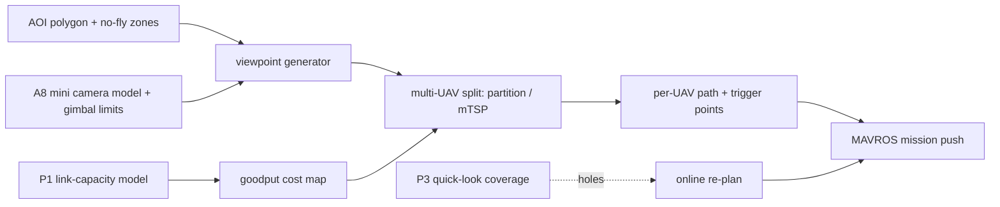

# P2 Path planning for photogrammetry — Technical

[← Main doc](../../docs/README.md) · [P2 overview](../README.md) · [Academic](academic.md)

How missions are computed, simulated and flown.

## Planner architecture



## Camera and footprint math

For a nadir camera at height *h* above ground, with pixel pitch *p*, focal length *f* and image size *W* × *H* px:

```latex
\mathrm{GSD} = \frac{p \, h}{f} = \frac{2h\tan(\mathrm{HFOV}/2)}{W}, \qquad
\text{footprint} = \mathrm{GSD}\cdot W \times \mathrm{GSD}\cdot H
```

```latex
\text{line spacing} = \mathrm{GSD}\cdot W\,(1 - o_{\text{side}}), \qquad
\text{trigger distance} = \mathrm{GSD}\cdot H\,(1 - o_{\text{fwd}})
```

The examples below assume the SIYI A8 mini at zoom 1× (3840 × 2160 px, HFOV 81°, so f ≈ 2250 px; see [P3 camera notes](../../photogrammetry/docs/technical.md#camera-siyi-a8-mini)), gimbal locked at nadir, with the long side across track and 70% side / 80% forward overlap.

| Height | GSD | Footprint | Line spacing | Trigger distance | Interval at 8 m/s |
| --- | --- | --- | --- | --- | --- |
| 50 m | 2.22 cm | 85 × 48 m | 25.6 m | 9.6 m | ~1.2 s |
| 80 m | 3.56 cm | 137 × 77 m | 41.0 m | 15.4 m | ~1.9 s |
| 120 m | 5.34 cm | 205 × 115 m | 61.5 m | 23.1 m | ~2.9 s |

These are calculated from vendor specs. If the stills turn out to be 4096 px wide, GSD drops by ~6%. Recompute from calibrated intrinsics before the first flight. The wide FOV means the image edges already look ~40° off nadir, and GSD there is coarser than the table shows. The trigger interval must also stay above the A8 mini's minimum shot interval (*verify*).

**Oblique shots** with the gimbal pitched θ from nadir (vertical FOV φ) cover the ground from *h*·tan(θ − φ/2) to *h*·tan(θ + φ/2) out from the nadir point. GSD at the image centre is roughly GSD<sub>nadir</sub> / cos θ across the tilt direction and GSD<sub>nadir</sub> / cos²θ along it. At θ = 30°, that is about 1.15× and 1.33× the nadir GSD.

**Oblique strategies with one gimbal camera (decide in SITL first).** The A8 mini gimbal covers pitch −90° to +25° and yaw ±135° (*verify* on our unit). The capture node on the Pi sets the angle through the SIYI SDK; PX4 does not drive the gimbal.

| Option | How | Pro | Con |
| --- | --- | --- | --- |
| A | Nadir grid, then separate oblique passes with a fixed gimbal pitch (e.g. 30° off nadir) | Simple; the gimbal never moves mid-leg | Extra flight lines; flight time grows with each view direction |
| B | Gimbal yaw/pitch swept between triggers (e.g. nadir → left → right) on one grid | Several view directions per pass | Slew + settle time limits the trigger rate; needs gimbal attitude per shot |
| C | Nadir only, relying on the wide 81° HFOV for edge obliquity | Shortest flight | Weaker oblique geometry; the baseline for RQ2.2 |

## Software stack

| Component | Tool |
| --- | --- |
| Geometry | Python, Shapely, pyproj (UTM) |
| Area split + routing | Polygon partition (equal-area strips) + Google OR-Tools VRP/mTSP |
| Goodput cost | Grid raster built from the P1 link-capacity model (hops, distance, altitude) |
| Quality score | Smith-style heuristics on a coarse DEM (Copernicus DEM or the first quick-look map) |
| Mission upload | MAVROS `/mavros/mission/push` (waypoints + `DO_SET_CAM_TRIGG_DIST`), or MAVSDK |
| Simulation | PX4 SITL + Gazebo (Harmonic), multi-vehicle launch |
| Network emulation | `tc netem` between SITL containers, driven by the link-capacity model; Mininet-WiFi as an option (*verify* batman-adv support) |

```bash
# example: emulate a 2-hop link at 4 Mbit/s, 40 ms, 2% loss between containers
tc qdisc add dev veth-uav1 root netem rate 4mbit delay 40ms 10ms loss 2%
```

## Mission conventions

- Altitude AGL, constant per mission, with terrain following off in phase 1.
- PX4 on the Pixracer triggers by distance (`TRIG_INTERFACE` = MAVLink, `TRIG_MODE` distance or survey). The Pi fires the A8 mini on each `CAMERA_TRIGGER` ([P3 trigger chain](../../photogrammetry/docs/technical.md#capture-and-geotagging)). Trigger counts are logged for geotag checks.
- Each leg carries its gimbal set-point (pitch, yaw) in `plan.json`. The capture node applies it at the leg's start waypoint.
- Turn-around legs extend beyond the AOI so no image is taken mid-turn. Piras et al. 2017 saw 2.3 m offsets at turns.
- Each UAV flies its own altitude layer (≥ 5 m apart) for basic separation.

## Technical todo

- [ ] Camera model module for the A8 mini (intrinsics → GSD, footprint, oblique footprint at a gimbal angle)
- [ ] Lawnmower and double-grid generators → MAVROS missions; check in QGroundControl
- [ ] Multi-vehicle PX4 SITL + Gazebo launch; tc-netem link emulation driven by the P1 model
- [ ] Goodput cost raster and OR-Tools mTSP with the cost term
- [ ] Coverage checker (simulated footprints → % AOI at the target overlap)
- [ ] Online re-plan service: subscribe to P3 coverage holes, push mission updates
- [ ] Flight campaign B runbook (same AOI, all planners, same day)
